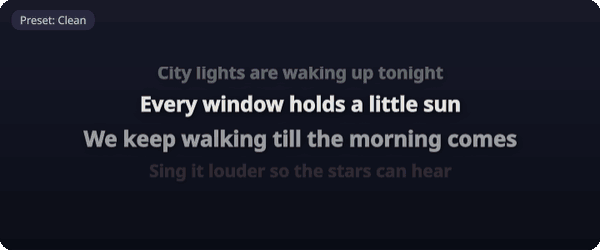
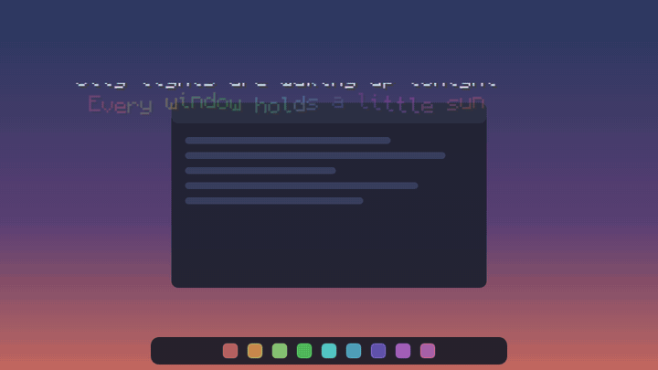
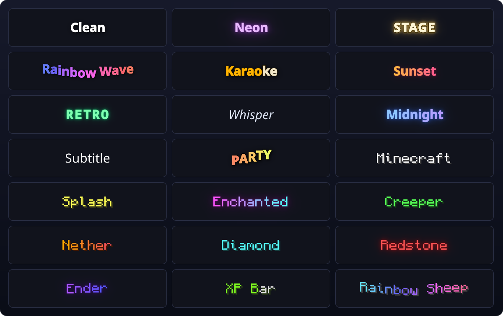
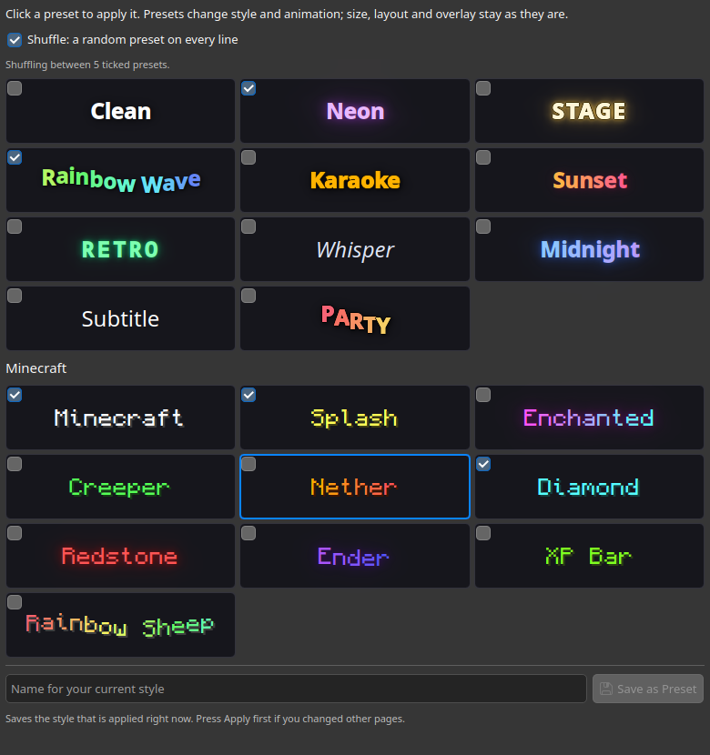

<p align="center">
  
</p>

<p align="center">
  <b>Time-synced lyrics for whatever is playing on Spotify, right on your KDE Plasma desktop.</b><br>
  As a widget, a line in your panel, or a click-through overlay above your windows.
</p>

<p align="center">
  
  
  
</p>

<p align="center">
  <a href="#features">Features</a> ·
  <a href="#presets">Presets</a> ·
  <a href="#install">Install</a> ·
  <a href="#usage">Usage</a> ·
  <a href="#settings">Settings</a> ·
  <a href="#faq">FAQ</a> ·
  <a href="#credits">Credits</a>
</p>

---

SMTL (Show Me The Lyrics) is a KDE Plasma 6 widget inspired by the Minecraft mod
[Show The Lyrics](https://www.curseforge.com/minecraft/mc-mods/show-the-lyrics).
It reads playback over MPRIS and fetches synced lyrics from [LRCLIB](https://lrclib.net),
so there is no Spotify login and no API key.

<p align="center">
  
</p>

## Features

- **Synced lyrics** that follow the song line by line, with a karaoke-style fill.
- **Three places to show them**: desktop widget, panel line, or an on-screen overlay you can click through.
- **21 presets** with live previews, including a Minecraft set using a bundled pixel font.
- **Shuffle**: a random preset on every line, from the ones you tick.
- **Random position**: each line pops up somewhere new on screen.
- **Deep customization**: fonts, solid/gradient/rainbow colour, outline, glow, shadows, wave, transitions, layout.
- **Works with other languages**: Korean, Japanese, Chinese, Cyrillic and more wrap and size correctly.
- **Save your own presets.**

<p align="center">
  
  <br><sub>Random position with shuffle. Demo lyrics are placeholders, rendered by the widget itself.</sub>
</p>

## Presets

<p align="center">
  
</p>

Pick one on the **Presets** page, tick several to shuffle between them, or save your own.

<p align="center">
  
</p>

## Requirements

- KDE Plasma 6
- Spotify desktop app (native or Flatpak). Other MPRIS players work with "Whatever is playing".
- The overlay needs Wayland.

## Install

```bash
git clone https://github.com/RenzSamilo/SMTL.git
```

```bash
kpackagetool6 -t Plasma/Applet -i SMTL/package
```

Then right-click the desktop or a panel → **Add Widgets** → **Show Me The Lyrics**.

To update after pulling new code:

```bash
kpackagetool6 -t Plasma/Applet -u SMTL/package
```

```bash
systemctl --user restart plasma-plasmashell
```

To remove it:

```bash
kpackagetool6 -t Plasma/Applet -r io.github.renzsamilo.smtl
```

## Usage

1. Add the widget and play a song on Spotify.
2. Right-click the widget → **Configure** to change how it looks.
3. For the HUD: **Overlay** → *Show lyrics on top of all windows*. Tick *Jump to a new spot on every line* for random positions.

## Settings

| Page | What it controls |
| --- | --- |
| **General** | Spotify only or any player, sync offset, behaviour when paused or when a song has no synced lyrics |
| **Presets** | Click to apply, save your own, Minecraft set, Shuffle |
| **Style** | Font, size, colour mode, outline, glow / drop / pixel shadow, backdrop |
| **Animation** | Line transition, karaoke fill, wave, rainbow speed |
| **Layout** | Lines before/after, alignment, spacing, size and opacity of other lines |
| **Overlay** | Screen position, random position, margins, width, opacity |

## FAQ

**Nothing shows up.** Make sure a song is actually playing. Some songs have no synced lyrics on LRCLIB; the widget then shows the title.

**Lyrics are early or late.** Adjust *Sync offset* on the General page.

**I changed the code and nothing happened.** Plasma keeps the old version loaded. Update the package and restart the shell (see Install).

**Why does the karaoke fill move evenly?** LRCLIB provides timing per line, not per word.

## Development

Try it in a window without installing:

```bash
plasmawindowed "$PWD/package"
```

Run the tests:

```bash
node tests/lyrics.test.js
```

```bash
node tests/text.test.js
```

Code layout:

- `package/contents/code/` – LRC parsing and LRCLIB lookup, presets, text wrapping
- `package/contents/ui/` – player tracking, rendering, overlay
- `package/contents/ui/config/` – settings pages

Issues and pull requests are welcome.

## Credits

- Lyrics: [LRCLIB](https://lrclib.net)
- Font: [Monocraft](https://github.com/IdreesInc/Monocraft) by Idrees Hassan (SIL OFL 1.1), bundled in `package/contents/fonts/`. It is a look-alike; Mojang's font is not included.
- Inspiration: the [Show The Lyrics](https://www.curseforge.com/minecraft/mc-mods/show-the-lyrics) Minecraft mod

Not affiliated with Spotify, Mojang or Microsoft.

## License

[MIT](LICENSE)
